# Blackstar: chine forebody lift in a desktop wind tunnel

How much lift do chines add to an aircraft forebody, and which chine shape adds the most? This repository holds a 160-run wind-tunnel campaign on 26 3D-printed nose cones: 25 chined configurations (5 chine angles θ × 5 chine widths λ) plus one plain, no-chine reference, each tested at 5 angles of attack. Lift was measured with a load cell on an automated, ESP32-controlled rig.

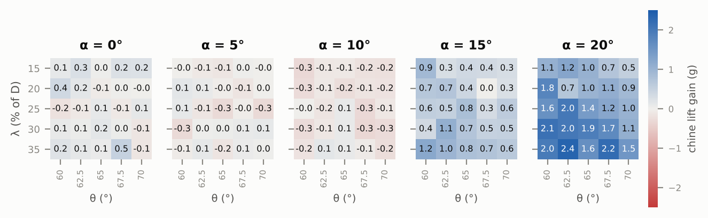

*Chine lift gain in grams (specimen lift minus no-chine lift) for all 125 configurations. Blue means more lift than the plain nose, red means less.*

## Key results

- **Chines do nothing at low incidence.** At 0°, 5° and 10° angle of attack the gain sits inside the noise (|mean| ≤ 0.14 g).
- **Above 10° they add lift, and the gain grows quickly.** At 15° the chined noses average **+0.59 g (+3.2%)** over the plain nose; at 20° they average **+1.43 g (+6.5%)**.
- **Chine width λ is the dominant variable.** At 20° the gain rises from +0.92 g at λ = 15% to +1.93 g at λ = 35% (p < 0.001).
- **Chine angle θ is secondary.** At 20° the gain falls from +1.70 g at θ = 60° to +1.01 g at θ = 70° (p = 0.016).
- **Best configuration: λ 35%, θ 62.5°**, at +2.36 g (+10.8%) at 20°. The weakest is λ 15%, θ 70°, at +0.54 g (+2.5%).
- **As a lift coefficient** (on the 67.8 cm² planform, with a common ±8% from the manometer reading): the plain nose reaches C<sub>L</sub> = 0.54 at 20°, the best chine 0.60 (ΔC<sub>L</sub> = +0.06). The Reynolds number on the mean aerodynamic chord is only about 3.7×10⁴ ([Lift coefficient](#lift-coefficient)).
- **The rig's "drift" was airflow, not sensor drift.** Lift is still coming off the model for more than 3 s after the motors cut. Correcting for it removed a 7% low bias and made repeat runs agree to 0.05 g ([Data processing](#data-processing)).

The pattern is the expected signature of chine vortex lift: nothing at low incidence, then a gain that grows non-linearly once the crossflow is strong enough for the sharp chine edge to shed a vortex.

---

## The experiment

### Tunnel and balance

| Tunnel | Load cell under the test-section floor |
|:---:|:---:|
| 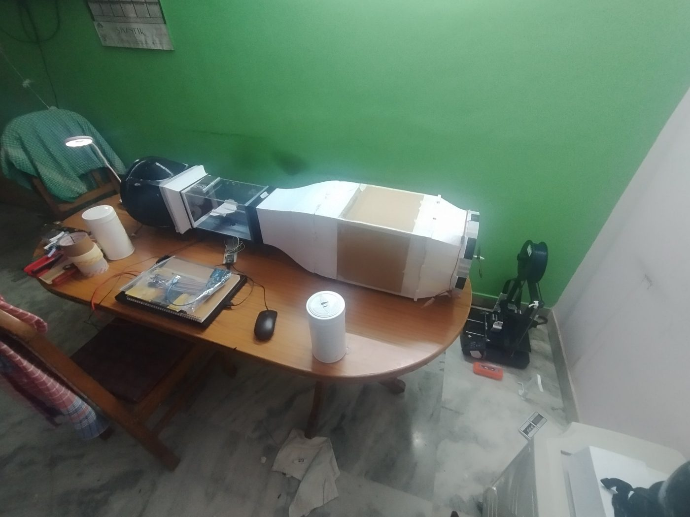 | 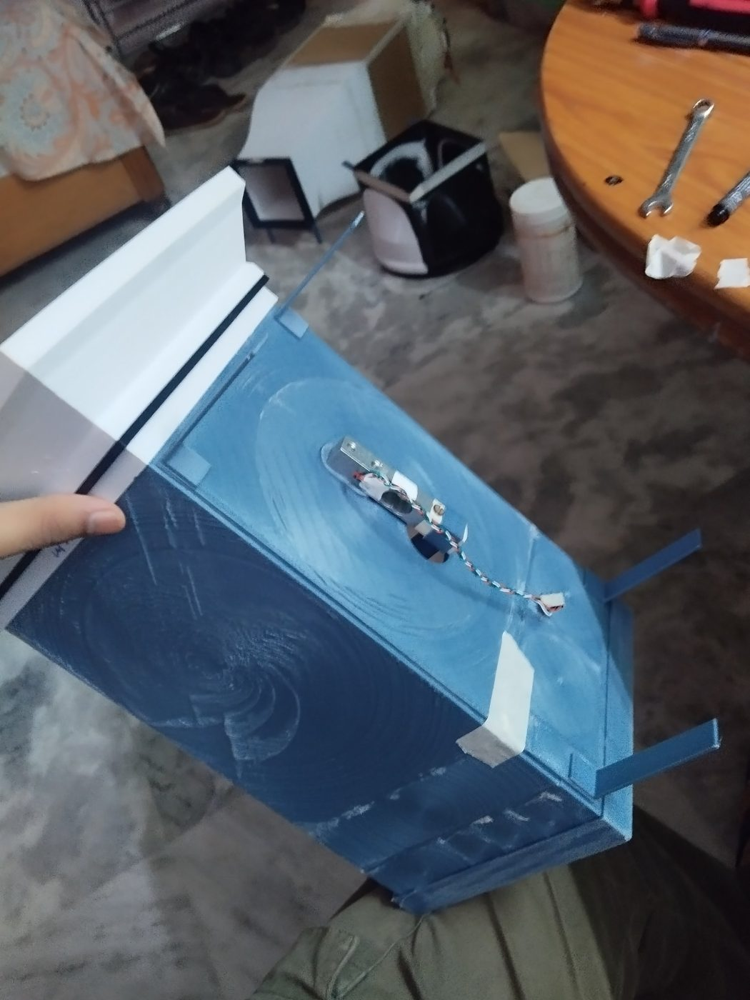 |
| **Honeycomb flow straightener** | **Printed specimens** |
| 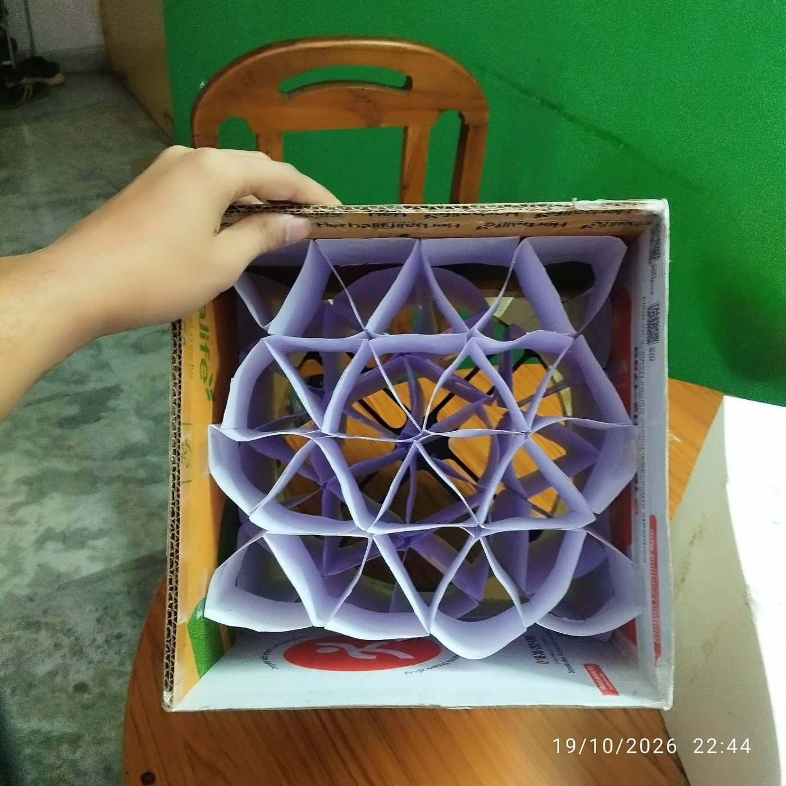 | 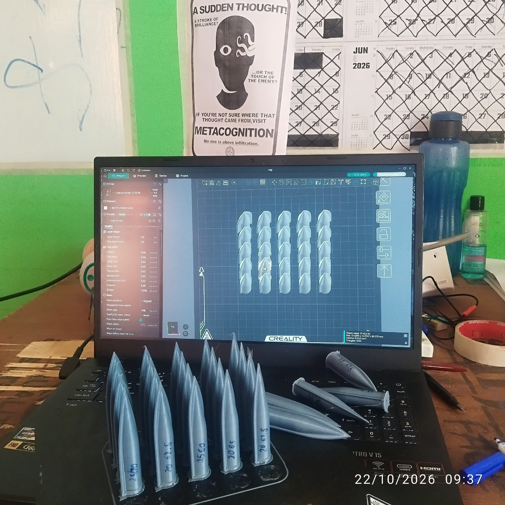 |

- **Tunnel:** open-circuit desktop tunnel with a honeycomb flow straightener, a contraction and a clear test section, driven by two 1100 KV brushless fans on a 12 V, 2 A supply.
- **Balance:** the specimen sits on a leg that passes through the test-section floor onto a 5 kg bar load cell, read by an HX711 amplifier at 11.3 Hz.
- **Angle of attack:** set with 3D-printed angle gauges pressed between the leg and the specimen. The specimen is screwed tight to the leg and the gauge is removed before the run.
- **Calibration:** a stack of coins weighed on a jeweller's scale. The cell is tared with the specimen resting and the flow off, so specimen weight cancels out, and lift reads positive.
- **Control:** an ESP32 runs the whole sequence by itself, serves a web interface over its own Wi-Fi network, and hands each run's samples to the browser for storage and CSV export ([firmware](firmware/blackstar_rig/blackstar_rig.ino)).

### Specimens

| Variable | Levels | Meaning |
|---|---|---|
| θ | 60, 62.5, 65, 67.5, 70° | chine angle at the nose tip |
| λ | 15, 20, 25, 30, 35% | chine width c as a percentage of body diameter D (c = λ·D) |
| α | 0, 5, 10, 15, 20° | angle of attack |

That gives 5 × 5 × 5 = 125 chined cells, plus the no-chine nose at every angle.

**Reference area.** Lift coefficients use the planform area from the model's CAD sketch: 125 mm span, 45° leading-edge sweep, a flat tip 14.375 mm wide, a 62.5 mm rake out to the full span, then 23.4375 mm of straight tips to the trailing edge. That gives S = 6784 mm² (67.8 cm²), root chord 78.75 mm, mean aerodynamic chord 59.9 mm and aspect ratio 2.3.

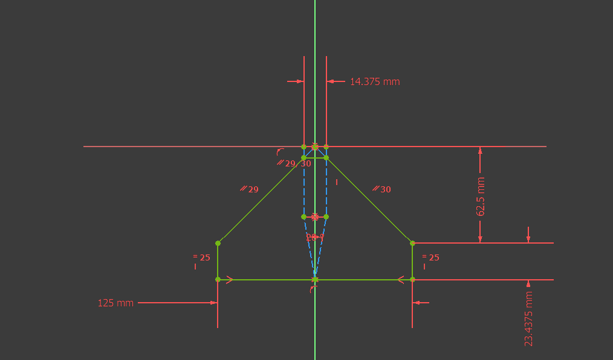

### Test sequence

Every run is identical and fully automated:

| Phase | Duration | Motors |
|---|---|---|
| Initial baseline | 3 s | off |
| Motor 1 climb | ≈ 4 s | M1 → 20% at 5%/s |
| Motor 1 settle | 5 s | M1 at 20% |
| Motor 2 climb | ≈ 5 s | M2 → 25% at 5%/s |
| Hold | 5 s | M1 20%, M2 25% |
| Ramp-down | 0.2 s | both → idle |
| Post baseline | 3 s | off |

Each phase value is the mean of its last 2 s. The lift reported here is the hold value.

### Test matrix and run order

The campaign ran in one block per angle of attack, so the angle gauge only had to change five times. Inside each block, specimens were **picked blind from a box**, so the run order is random. A slow drift therefore shows up as a trend against time rather than as a fake geometry effect ([checked below](#checks)).

| α | Chined runs | Cells | No-chine runs | Block length |
|---|---|---|---|---|
| 0° | 32 | 25/25 | 1 | 74 min |
| 5° | 27 | 25/25 | 6 | 77 min |
| 10° | 27 | 25/25 | 5 | 55 min |
| 15° | 25 | 25/25 | 5 | 49 min |
| 20° | 27 | 25/25 | 5 | 34 min |

160 runs in total: 138 chined (125 cells plus 13 repeats) and 22 no-chine.

---

## Data processing

### The airflow tail

The rig originally took its zero as a straight line from the initial baseline to the post baseline, and logged the difference as "drift". At 20° that drift averaged about 2 g. The data show it is not drift.

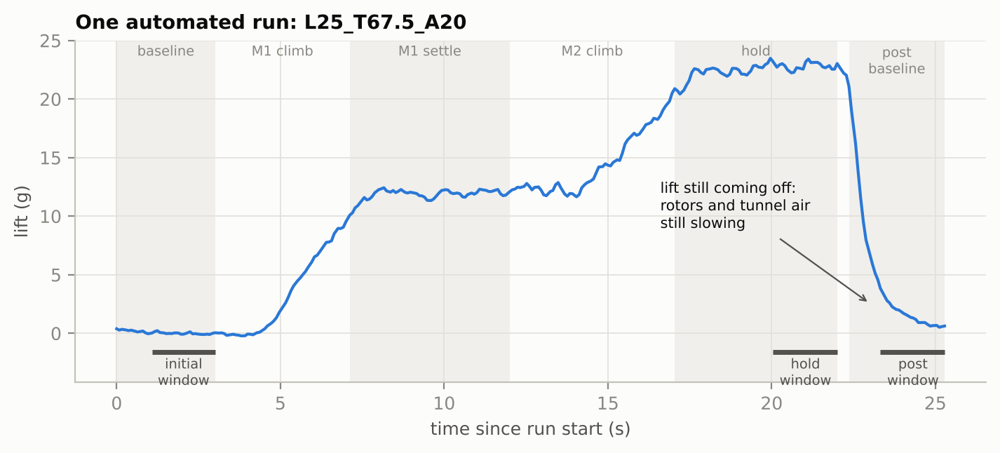

The post baseline begins 0.2 s after the motors are commanded to idle. At that point the rotors are still spinning down and the tunnel air is still moving. Averaged over all runs at 5°–20°, the residual lift is:

| Time after post phase starts | 0 s | 0.5 s | 1.0 s | 2.0 s | 3.0 s |
|---|---|---|---|---|---|
| Residual lift, % of hold | 88.8 | 41.2 | 18.3 | 6.5 | 4.0 |

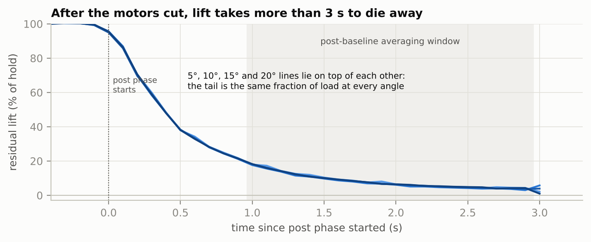

The curves for every angle fall on top of each other, so the residual is a fixed fraction of the load. Across all 160 runs, the post-baseline offset is **8.4% of the run's lift** (r = 0.82). Load-cell drift or creep does not follow each run's aerodynamic load like this.

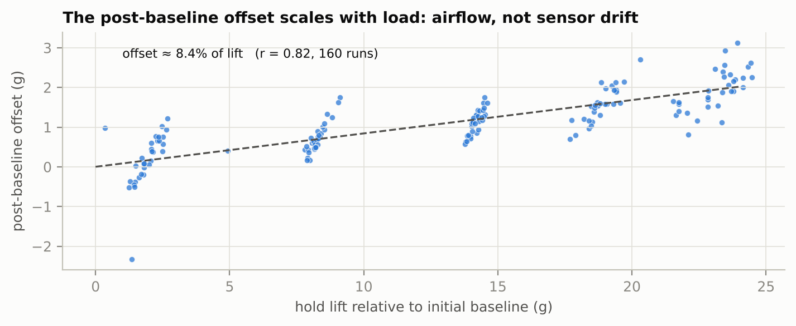

The initial baseline, taken before the motors start, is clean: its slope never averages more than 0.014 g/s in any block, and its noise is 0.09 g.

### Corrected zero

The post baseline carries two things: the airflow tail (a bias) and real zero shifts that happen during a run, most likely the specimen or leg seating under vibration. Those shifts persist after the flow stops, so they should still be subtracted. The correction removes only the airflow part.

With $z_\text{pre}$, $h$ and $z_\text{post}$ the mean readings of the initial-baseline, hold and post-baseline windows, $F$ the calibration factor in counts per gram, and $t$ the window centre times:

$$L_0 = \frac{z_\text{pre} - h}{F}, \qquad \Delta = \frac{z_\text{pre} - z_\text{post}}{F} - k\,L_0, \qquad L = L_0 - \frac{t_\text{hold} - t_\text{pre}}{t_\text{post} - t_\text{pre}}\,\Delta$$

Here $L_0$ is lift relative to the initial baseline, $k = 0.084$ is the airflow-tail fraction fitted across all runs, $\Delta$ is the run-specific zero shift, and $L$ is the corrected lift.

Why this zero and not a simpler one:

| Zero used | No-chine lift at 20° | Repeat scatter (rms) |
|---|---|---|
| Straight line to the post baseline (original) | 20.40 g (about 7% low) | 0.07 g |
| Initial baseline only | 21.69 g | 0.46 g |
| **Corrected (used here)** | **21.95 g** | **0.05 g** |

The original zero is repeatable but biased low. The initial baseline alone removes the bias but leaves every run's zero shift in, so repeats scatter six times more. The corrected zero keeps the precision without the bias.

### Chine gain

Chine gain is specimen lift minus the mean no-chine lift at the same angle of attack. Where a configuration was run more than once, the median is used.

### Data quality

| α | No-chine lift | No-chine repeat sd | Cell-to-cell sd of gain |
|---|---|---|---|
| 0° | 1.84 g | – (1 run) | 0.16 g |
| 5° | 8.26 g | 0.06 g | 0.13 g |
| 10° | 14.36 g | 0.09 g | 0.13 g |
| 15° | 18.37 g | 0.20 g | 0.28 g |
| 20° | 21.95 g | 0.18 g | 0.52 g |

- **Rejected runs:** 37, 40 and 41, three early 0° runs. Each was contradicted by more than 1 g by its own retest (runs 38, 42 and 43), while the retests agreed with the rest of the block. They stay in `data/processed/runs.csv` with `rejected = 1`.
- **Calibration:** the scale factor was redone twice during the 0° block (−397.6, −408.8, −423.3 counts/g), a 6.4% spread. Every run from 46 onward, which covers all of the 5°–20° data, shares one factor.

---

## Results

### Lift curve

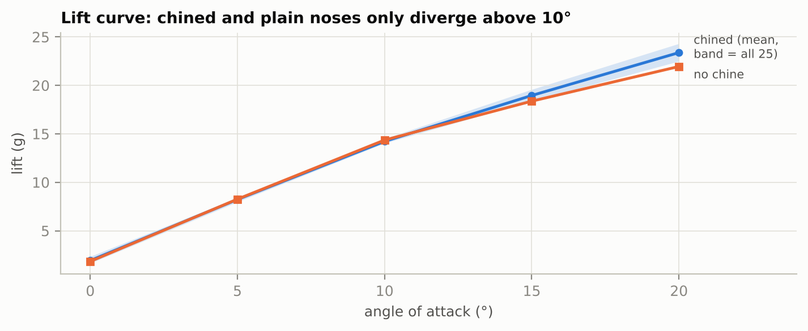

The chined and plain noses produce the same lift up to 10°. Above that the chined noses pull ahead, and every one of the 25 configurations lands above the plain nose at 20°.

### Lift coefficient

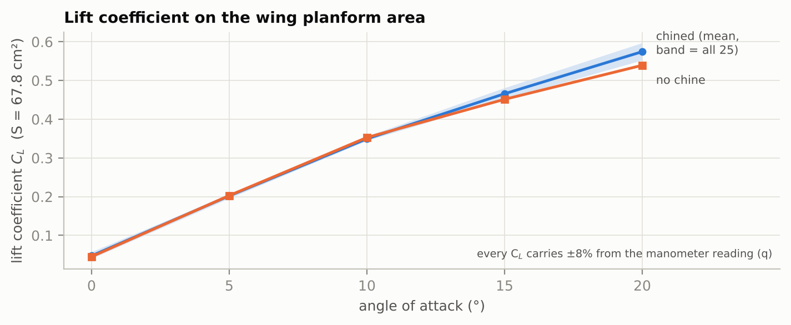

C<sub>L</sub> = L / (q·S), with q = 58.9 Pa from the manometer (6 mm H₂O, which needs no air density) and S = 6784 mm². One gram of lift is C<sub>L</sub> = 0.0246.

| α | No-chine C<sub>L</sub> | Chined mean C<sub>L</sub> | Mean ΔC<sub>L</sub> |
|---|---|---|---|
| 0° | 0.045 | 0.047 | +0.002 |
| 5° | 0.203 | 0.202 | −0.001 |
| 10° | 0.353 | 0.349 | −0.003 |
| 15° | 0.451 | 0.466 | +0.014 |
| 20° | 0.539 | 0.574 | +0.035 |

The best configuration (λ 35%, θ 62.5°) reaches C<sub>L</sub> = 0.597 at 20°, which is ΔC<sub>L</sub> = +0.058 over the plain nose. The ±0.5 mm manometer reading error is ±8% in q, and it moves every coefficient by the same factor, so the comparisons between configurations (the ΔC<sub>L</sub> column and the percentages) are as certain as the gram differences. The absolute values are not. At about 10 m/s the Reynolds number on the mean aerodynamic chord (59.9 mm) is only about 3.7×10⁴, far below full scale, so absolute coefficients and the size of the chine effect may differ at the aircraft's Reynolds number.

### Where the gain appears

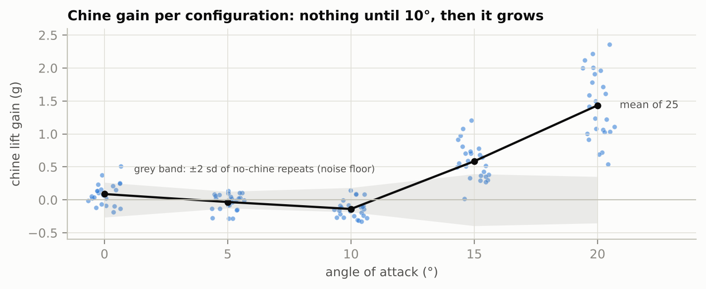

| α | Mean chine gain | % of no-chine lift | θ effect p | λ effect p |
|---|---|---|---|---|
| 0° | +0.09 g | – | 0.69 | 0.53 |
| 5° | −0.03 g | −0.4% | 0.84 | 0.78 |
| 10° | −0.14 g | −1.0% | 0.04 | 0.40 |
| 15° | **+0.59 g** | **+3.2%** | 0.06 | **0.03** |
| 20° | **+1.43 g** | **+6.5%** | **0.016** | **< 0.001** |

p-values come from a two-way additive model (θ + λ + time into block) fitted at each angle, with one run per cell. At 10°, θ reaches p = 0.04, but its spread is only about 0.2 g, and with ten tests in this table one result at that level is expected by chance. The 0° gain is not expressed as a percentage because that block's no-chine reference rests on a single run.

### Which geometry matters

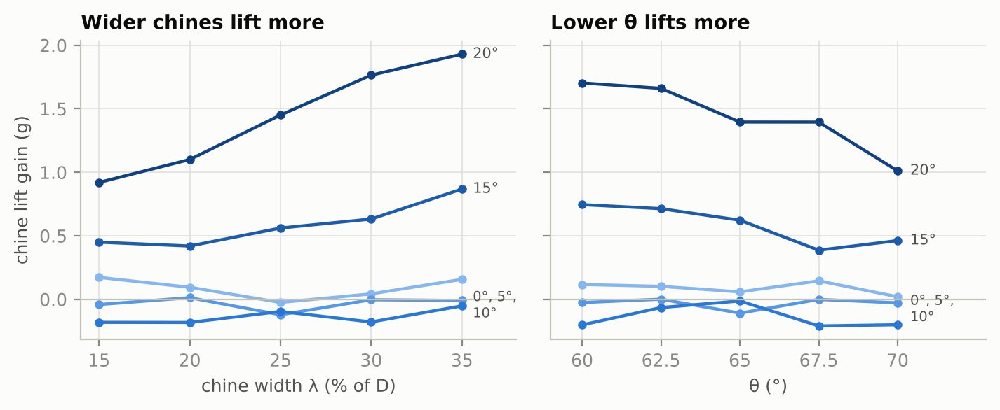

At 20°, averaged over θ, the gain climbs steadily with chine width:

| λ (% of D) | 15 | 20 | 25 | 30 | 35 |
|---|---|---|---|---|---|
| Gain at 20° (g) | +0.92 | +1.10 | +1.45 | +1.76 | +1.93 |
| Gain at 15° (g) | +0.45 | +0.42 | +0.56 | +0.63 | +0.87 |

Averaged over λ, θ works the other way:

| θ (°) | 60 | 62.5 | 65 | 67.5 | 70 |
|---|---|---|---|---|---|
| Gain at 20° (g) | +1.70 | +1.66 | +1.40 | +1.40 | +1.01 |
| Gain at 15° (g) | +0.75 | +0.71 | +0.62 | +0.39 | +0.46 |

### Best and worst at 20°

| Rank | λ | θ | Lift | Chine gain | vs plain nose |
|---|---|---|---|---|---|
| 1 | 35% | 62.5° | 24.31 g | +2.36 g | +10.8% |
| 2 | 35% | 67.5° | 24.17 g | +2.22 g | +10.1% |
| 3 | 30% | 60° | 24.06 g | +2.12 g | +9.6% |
| 4 | 30% | 62.5° | 23.96 g | +2.01 g | +9.1% |
| 5 | 25% | 62.5° | 23.95 g | +2.00 g | +9.1% |
| … | | | | | |
| 21 | 20% | 65° | 22.96 g | +1.01 g | +4.6% |
| 22 | 20% | 70° | 22.86 g | +0.91 g | +4.2% |
| 23 | 15% | 67.5° | 22.67 g | +0.72 g | +3.3% |
| 24 | 20% | 62.5° | 22.64 g | +0.69 g | +3.2% |
| 25 | 15% | 70° | 22.49 g | +0.54 g | +2.5% |

Eight of the top ten configurations have λ ≥ 30%. The no-chine nose makes 21.95 g at 20°. All 125 configurations are in [`data/processed/configurations.csv`](data/processed/configurations.csv).

---

## Checks

**No drift across blocks.** From 10° upward the no-chine reference was only run at the start of each block, so slow drift during a block would not show in the reference. Because the specimens were picked at random, it would show as a trend against time instead. No block has a significant trend (all p > 0.1). The largest slope, +0.075 g per 10 min at 20°, could account for at most about 0.2 g over the 30 minutes of chined runs in that block, far below the 1.43 g effect.

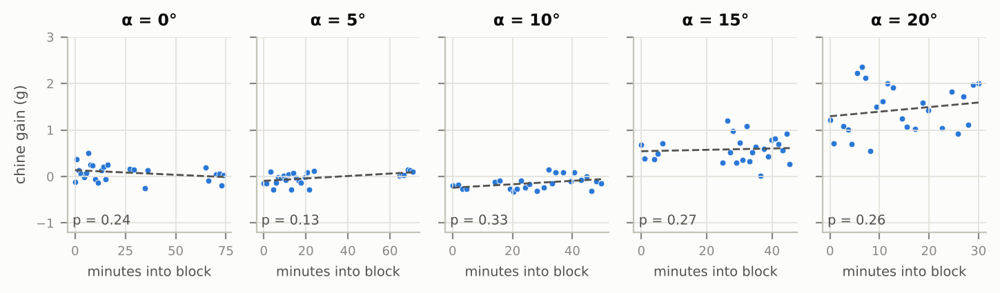

## Limitations

- **Airspeed is only roughly known.** A water manometer read 6 mm H₂O (about 59 Pa) at the test throttle (M1 20%, M2 25%, 12 V, 2 A). One manometer tube faced into the flow and the other was orthogonal to it, so the difference is the dynamic pressure, which gives about 10 m/s (assuming air density 1.1 kg/m³). A ±0.5 mm reading error is ±4% in speed and ±8% in dynamic pressure, so every lift coefficient carries ±8% (one common factor, so comparisons between configurations are unaffected). This was a single manual reading, not logged per run. The Reynolds number on the mean aerodynamic chord is only about 3.7×10⁴, far below full scale, so absolute coefficients may not transfer to the aircraft. Comparisons between configurations are valid; comparisons with other tunnels are not.
- **One run per cell.** The geometry effects are tested against the cell-to-cell scatter left after fitting θ and λ, which includes the error of re-mounting each specimen at its angle. Repeat runs agree to 0.05 g, but most were taken back to back, so they may not capture re-mounting error.
- **No-chine reference at the start of blocks only** for 10°–20°, and a single no-chine run at 0°.
- **Hold not fully settled.** Lift is still creeping up by 0.2–0.5% per second during the hold window. The creep is the same for every specimen, so the comparisons hold, but a longer hold would read slightly higher absolute lift.
- **Calibration spread** of 6.4% across the 0° block (see [Data quality](#data-quality)).

## Next steps

- Optional retests, each about 2 standard deviations from what its row and column predict: `L20_T62.5_A20` (run 161), `L30_T60_A05` (run 70), `L30_T60_A15` (run 129). None changes a conclusion.
- Four more no-chine runs at 0°.
- Extend the post baseline to about 10 s so the airflow tail has fully decayed before the zero is taken.
- Fit a pitot tube with a low-range differential pressure sensor, calibrated against a water U-tube, to log airspeed per run and tighten the lift coefficients.
- Flow visualisation (smoke or mist) to see the chine vortices directly.

---

## Repository layout

```
.
├── README.md
├── analysis/
│   ├── analyze.py          # reproduces every number and figure in this README
│   ├── requirements.txt
│   └── results.json        # numbers quoted above, written by analyze.py
├── data/
│   ├── raw/
│   │   ├── blackstar_raw_2026-10-27.csv       # every sample of every run, as exported by the rig
│   │   └── blackstar_summary_2026-10-27.csv   # per-run metadata and calibration factor
│   └── processed/
│       ├── runs.csv             # one row per run, corrected lift, chine gain and lift coefficient
│       ├── configurations.csv   # one row per configuration (125)
│       └── no_chine.csv         # no-chine reference per angle
├── docs/images/            # rig photos and the planform sketch
├── figures/                # charts generated by analyze.py
└── firmware/blackstar_rig/
    └── blackstar_rig.ino   # ESP32 rig firmware and web interface, as used for this campaign
```

**Raw data columns** (`blackstar_raw_*.csv`): `run_id`, `specimen_id`, `aoa_deg`, `lambda_pct`, `theta_deg`, `is_no_chine`, `rep`, `t_ms` (ms since run start), `phase` (1 baseline, 2 M1 climb, 3 M1 settle, 4 M2 climb, 5 hold, 6 ramp-down, 7 post baseline), `raw_counts` (HX711), `m1_us` and `m2_us` (ESC pulse widths), and `lift_g` (the rig's original on-board estimate, superseded by `data/processed`).

Specimen IDs read `L<λ>_T<θ>_A<α>`, for example `L35_T62.5_A20`. `NC_A<α>` is the no-chine nose.

## Reproduce

```bash
pip install -r analysis/requirements.txt
python analysis/analyze.py
```

The script reads `data/raw/` and rewrites `data/processed/`, `figures/` and `analysis/results.json`.

## Hardware

| Part | Notes |
|---|---|
| ESP32 dev board | Arduino IDE, library `ESP32Servo` |
| HX711 amplifier + 5 kg bar load cell | powered from 3.3 V |
| 2 × 1100 KV brushless motors + ESCs | 12 V, 2 A supply |

| Connection | ESP32 pin |
|---|---|
| ESC 1 signal | GPIO 18 |
| ESC 2 signal | GPIO 19 |
| HX711 DT | GPIO 32 |
| HX711 SCK | GPIO 33 |
| HX711 VCC / GND | 3V3 / GND |
| ESC grounds | GND (common ground required) |

Flash the firmware, join the ESP32's Wi-Fi network (name and password are set at the top of the sketch), and open `http://192.168.4.1`. The page lets you choose λ, θ and α from drop-downs, runs the sequence on the space bar, shows a live load trace and a coverage grid, and exports CSV.

## Credits and AI assistance

The ESP32 firmware, its web page and the analysis script (`analysis/analyze.py`) were written with AI assistance (Claude, by Anthropic) from my requirements. I designed and 3D-printed the tunnel and test specimens, wired the rig, flashed and ran the firmware, calibrated the load cell, and collected every run. The airflow-tail explanation and the correction were worked out with the AI assistant from my data. I noticed the post-run bump, chose to handle it in the calculations and not change the working firmware, and proposed the "final minus initial" comparison.
